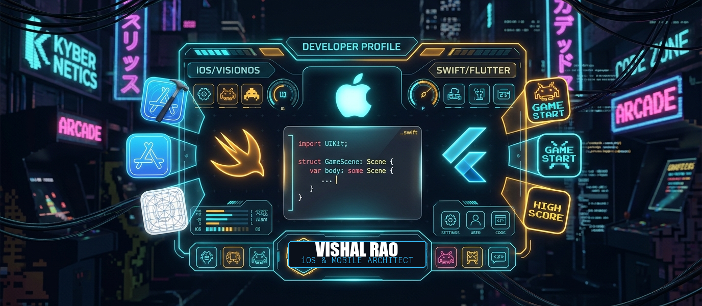

<div align="center">
  <!-- Custom Cyberpunk Arcade iOS Banner -->
  <a href="https://vishalrao-portfolio.netlify.app/" target="_blank">
    
  </a>

  <br/><br/>

  <!-- 8-Bit Retro Pixel Font Typing SVG -->
  <a href="https://git.io/typing-svg">
    
  </a>

  <br/>

  <!-- Multiplayer Party / Guild Links -->
  <p align="center">
    <a href="https://vishalrao-portfolio.netlify.app/" target="_blank">
      
    </a>
    <a href="https://linkedin.com/in/vishal-rao-173a232b9" target="_blank">
      
    </a>
    <a href="mailto:vishalrao5432@gmail.com">
      
    </a>
    <a href="https://discord.com" target="_blank">
      
    </a>
    <a href="https://www.instagram.com/_f.r.e.a.k.y.vr_" target="_blank">
      
    </a>
  </p>
</div>

<!-- Glowing Neon Laser Divider -->


### 👾 Character HUD & Player Sheet

<table border="0" width="100%">
  <tr>
    <td width="58%" valign="top">

```swift
final class PlayerOne: iOSLegend {
    let handle: String      = "vishal-rao28 🎮"
    let roleClass: String   = "Grandmaster iOS & Mobile Crafter 🧙‍♂️"
    let playerLevel: Int    = 99
    let activeGuild: String = "Apple Developer Ecosystem 🍎"

    // Live Player Gauges
    var staminaGauge: String = "☕ [██████████] 100% Espresso"
    var manaPool: String     = "⚡ [██████████] Infinite Logic"
    var agility: String      = "📱 120 FPS SwiftUI ProMotion"
    var ultimateMove: String = "Compile With Zero Warnings 🚀"

    // Core Loadout
    var weapons: [Item] = [.swift, .swiftUI, .flutter, .combine]
}
```

- 🎯 **Primary Quest:** Slaying latency & building buttery-smooth mobile apps.
- 📜 **Skill Tree:** SwiftUI, UIKit, Clean MVVM, Reactive Programming, Combine & CoreData.
- 🏆 **Achievement Unlocked:** Pixel-perfect UI translations from Figma prototypes.

    </td>
    <td width="42%" align="center" valign="middle">
      
    </td>
  </tr>
</table>

<!-- Glowing Neon Laser Divider -->


### ⚔️ Weapon Arsenal & Skill Inventory

<div align="center">

| Gear Tier | Weapon Class | Equipped Items |
| :---: | :--- | :--- |
| **S+** | **🗡️ Primary Blades (Languages)** |  |
| **S** | **🛡️ Armor & Engines (Mobile Platforms)** |  |
| **A** | **🧪 Potions & Spells (Cloud & Backend)** |  |
| **A** | **🎒 Adventurer's Kit (Dev Suite & Design)** |  |

</div>

<br/>

<!-- Glowing Neon Laser Divider -->


### 🏰 Boss Dungeons & Active Raids (Featured Projects)

<table border="0" width="100%">
  <tr>
    <td width="50%" align="center" valign="top">
      <a href="https://github.com/vishal-rao28/Core-Care-iOS" target="_blank">
        
      </a>
      <br/>
      <sub><b>⚔️ Raid: Core-Care-iOS</b> — Healthcare mobile intelligence engineered with Swift & modular architecture.</sub>
    </td>
    <td width="50%" align="center" valign="top">
      <a href="https://github.com/vishal-rao28/BreathTracker.Swift" target="_blank">
        
      </a>
      <br/>
      <sub><b>🧘 Quest: BreathTracker.Swift</b> — Real-time respiratory analytics & mindfulness tracker with fluid SwiftUI UI.</sub>
    </td>
  </tr>
</table>

<br/>

<!-- Glowing Neon Laser Divider -->


### 📊 Battle Radar & Player XP

<div align="center">
  <table border="0">
    <tr>
      <td align="center">
        
      </td>
      <td align="center">
        
      </td>
    </tr>
  </table>

  <br />

  
</div>

<br/>

<!-- Glowing Neon Laser Divider -->


### 🕹️ Retro Arcade Arena: Pac-Man Devourer of Commits

<div align="center">
  <picture>
    <source media="(prefers-color-scheme: dark)" srcset="https://raw.githubusercontent.com/vishal-rao28/vishal-rao28/output/pacman-contribution-graph-dark.svg">
    <source media="(prefers-color-scheme: light)" srcset="https://raw.githubusercontent.com/vishal-rao28/vishal-rao28/output/pacman-contribution-graph.svg">
    
  </picture>
</div>

<br/>

<!-- Glowing Neon Laser Divider -->


### 📜 Tavern Lore (Daily Wisdom Scroll)

<div align="center">
  
</div>

<br/>

<div align="center">
  <p>💾 <b>CHECKPOINT REACHED • SAVE GAME COMPLETE</b></p>
  
  <br /><br />
  <sub>🎮 Drop a <b>[⭐ Star]</b> on my repos to give EXP, or <b>[Follow]</b> to join the guild! Built with <b>Swift & Passion</b> by <b>Vishal Rao</b> 🎮</sub>
</div>
