<div align="center">
  <!--  Master Apple iOS & visionOS Command Deck Banner (Non-clickable standalone image - PRESERVED) -->
  <a href="#-"></a>

  <br/><br/>

  <!-- 8-Bit Cyber Typing Headline -->
  <a href="https://git.io/typing-svg">
    
  </a>

  <br/>

  <!-- Quick Telemetry & Social Channels -->
  <p align="center">
    <a href="https://vishal-rao28.github.io/Vishal-s-portfolio/" target="_blank">
      
    </a>
    <a href="https://linkedin.com/in/vishal-rao-173a232b9" target="_blank">
      
    </a>
    <a href="mailto:vishalrao5432@gmail.com">
      
    </a>
    <a href="https://wa.me/916382190388" target="_blank">
      
    </a>
    <a href="https://www.instagram.com/_f.r.e.a.k.y.vr_" target="_blank">
      
    </a>
  </p>

  <!-- Quick Jump Anchor Bar -->
  <p align="center">
    <a href="#-executive-summary--architect-hud"><code>[ 👤 Architect HUD ]</code></a> •
    <a href="#-5-production-applications-live-on-apple-app-store"><code>[  5 App Store Apps ]</code></a> •
    <a href="#-on-device-ai--core-ml-architecture"><code>[ 🧠 On-Device AI ]</code></a> •
    <a href="#-4-gate-automated-quality-verification-pipeline"><code>[ 🛡️ 4 QA Gates ]</code></a> •
    <a href="#-technical-arsenal--frameworks"><code>[ ⚔️ Tech Arsenal ]</code></a> •
    <a href="#-github-battle-metrics"><code>[ 📊 Telemetry ]</code></a> •
    <a href="#-career-collaboration--contact"><code>[ 📬 Get In Touch ]</code></a>
  </p>
</div>

<!-- Glowing Neon Laser Divider -->


### 👤 Executive Summary & Architect HUD

<table width="100%" border="0" cellspacing="0" cellpadding="0">
  <tr>
    <td width="62%" valign="top">
      <!-- Xcode 16 Titanium Glass IDE Card -->
      <table width="100%" border="0" style="background-color: #030712; border: 1.5px solid #38bdf8; border-radius: 14px; padding: 0; overflow: hidden;">
        <!-- Window Title Bar -->
        <tr style="background-color: #0b1329;">
          <td colspan="2" style="padding: 10px 14px; border-bottom: 1px solid rgba(255,255,255,0.1);">
            <span style="color: #ef4444; font-size: 14px;">●</span>
            <span style="color: #f59e0b; font-size: 14px;">●</span>
            <span style="color: #10b981; font-size: 14px;">●</span>
            &nbsp;&nbsp;
            <code style="color: #cbd5e1; font-size: 11px;">Xcode 16.2 • VishalRaoArchitect.swift</code>
            <span align="right" style="float: right; color: #34d399; font-size: 10px; font-weight: bold;">● BUILD SUCCEEDED</span>
          </td>
        </tr>
        <tr>
          <td style="padding: 16px;">

```swift
final class VishalRao: NativeIOSArchitect {
    let identity: String       = "Vishal Rao M 👋"
    let specialization: String = "Native iOS 18 & On-Device Core ML AI"
    let education: String      = "B.E. Computer Science • SIMATS Chennai"
    let currentFocus: String   = "Apple Neural Engine (ANE) & Spatial Computing"

    //  Production Metrics & SLA
    let appStoreAppsLive: Int    = 5          // Verified Apple App Store
    let aneInferenceTime: String = "<12ms"    // Quantized FP16 Vision
    let displayRefreshSLA: String = "120 FPS Fluid ProMotion Guarantee"
    let automatedQAGates: Int    = 4          // Selenium, Appium, Keychain, Instruments

    // Primary Core Loadout
    var coreCompetencies: [Framework] = [
        .swift6, .swiftUI, .coreML, .vision, 
        .healthKit, .combine, .appium, .coreData
    ]
}
```

          </td>
        </tr>
      </table>
    </td>
    <td width="38%" valign="top" style="padding-left: 16px;">
      <!-- Architect Telemetry Dossier Card -->
      <table width="100%" border="0" style="background-color: #070b16; border: 1.5px solid #a855f7; border-radius: 14px; padding: 14px;">
        <tr>
          <td align="center">
            
            <br/><br/>
            <br/>
            <br/>
            
            <br/><br/>
            <span style="color: #cbd5e1; font-size: 11.5px; font-style: italic;">
              "Crafting fluid Apple ecosystem experiences where native performance meets on-device intelligence."
            </span>
          </td>
        </tr>
      </table>
    </td>
  </tr>
</table>

<!-- Glowing Neon Laser Divider -->


###  5+ Production Applications Live on Apple App Store

<div align="center">
  <!--  Master 5-App Interactive Command Deck with Real Ingested iPhone Screens -->
  <a href="https://vishal-rao28.github.io/Vishal-s-portfolio/#work" target="_blank">
    
  </a>
  <br/><br/>
</div>

<!-- ================= 5 LIVE APPS VISUAL EDITORIAL CARDS ================= -->
<table width="100%" border="0" cellspacing="0" cellpadding="0">
  <tr>
    <!-- Card 1: Viana 360 -->
    <td width="50%" valign="top">
      <table width="100%" border="0" style="background-color: #070b16; border: 1.5px solid #38bdf8; border-radius: 14px; padding: 14px;">
        <tr>
          <td width="52" valign="middle">
            
          </td>
          <td valign="middle">
            <b style="font-size: 15px; color: #ffffff;">Viana 360</b><br/>
            <span style="color: #38bdf8; font-family: monospace; font-size: 10px; font-weight: bold;">ENTERPRISE GPS &amp; BIOMETRICS</span>
          </td>
          <td align="right" valign="middle">
            <a href="https://apps.apple.com/in/app/viana-360/id6760163659" target="_blank">
              
            </a>
          </td>
        </tr>
        <tr>
          <td colspan="3" style="padding-top: 8px;">
            
            
            
            
            <br/><br/>
            <span style="color: #cbd5e1; font-size: 12px; line-height: 1.5;">
              🛰️ <b>Polygon Geofencing:</b> Real-time perimeter attendance tracking with hardware GPS.<br/>
              📱 <b>iPadOS Multitasking:</b> SplitView dashboard with zero-leak Instruments profile.
            </span>
            <br/><br/>
            <div align="center">
              <a href="https://apps.apple.com/in/app/viana-360/id6760163659" target="_blank">
                
              </a>
              &nbsp;
              <a href="https://vishal-rao28.github.io/Vishal-s-portfolio/#work" target="_blank">
                
              </a>
            </div>
          </td>
        </tr>
      </table>
    </td>

    <!-- Card 2: Smart Ulcer Predictor -->
    <td width="50%" valign="top" style="padding-left: 12px;">
      <table width="100%" border="0" style="background-color: #070b16; border: 1.5px solid #10b981; border-radius: 14px; padding: 14px;">
        <tr>
          <td width="52" valign="middle">
            
          </td>
          <td valign="middle">
            <b style="font-size: 15px; color: #ffffff;">Smart Ulcer Predictor</b><br/>
            <span style="color: #10b981; font-family: monospace; font-size: 10px; font-weight: bold;">CLINICAL ON-DEVICE AI</span>
          </td>
          <td align="right" valign="middle">
            <a href="https://apps.apple.com/in/app/smart-ulcer-predictor/id6755873140" target="_blank">
              
            </a>
          </td>
        </tr>
        <tr>
          <td colspan="3" style="padding-top: 8px;">
            
            
            
            
            <br/><br/>
            <span style="color: #cbd5e1; font-size: 12px; line-height: 1.5;">
              🧠 <b>Sub-Second ANE:</b> &lt;12ms quantized CNN tissue classification (Granulation / Slough).<br/>
              🔐 <b>100% Offline:</b> Patient biomedical images processed locally with zero cloud egress.
            </span>
            <br/><br/>
            <div align="center">
              <a href="https://apps.apple.com/in/app/smart-ulcer-predictor/id6755873140" target="_blank">
                
              </a>
              &nbsp;
              <a href="https://vishal-rao28.github.io/Vishal-s-portfolio/#work" target="_blank">
                
              </a>
            </div>
          </td>
        </tr>
      </table>
    </td>
  </tr>

  <tr><td colspan="2" height="14"></td></tr>

  <tr>
    <!-- Card 3: BreathTrack -->
    <td width="50%" valign="top">
      <table width="100%" border="0" style="background-color: #070b16; border: 1.5px solid #f43f5e; border-radius: 14px; padding: 14px;">
        <tr>
          <td width="52" valign="middle">
            
          </td>
          <td valign="middle">
            <b style="font-size: 15px; color: #ffffff;">BreathTrack</b><br/>
            <span style="color: #f43f5e; font-family: monospace; font-size: 10px; font-weight: bold;">MEDTECH &amp; TELEHEALTH</span>
          </td>
          <td align="right" valign="middle">
            <a href="https://apps.apple.com/in/app/breathtrack/id6804558579" target="_blank">
              
            </a>
          </td>
        </tr>
        <tr>
          <td colspan="3" style="padding-top: 8px;">
            
            
            
            
            <br/><br/>
            <span style="color: #cbd5e1; font-size: 12px; line-height: 1.5;">
              🫁 <b>Spirometry Telemetry:</b> Real-time SpO2 &amp; FVC telemetry with reactive Combine visualizers.<br/>
              📋 <b>Clinician Diagnostics:</b> Automated clinical PDF export and ABG trend forecasting.
            </span>
            <br/><br/>
            <div align="center">
              <a href="https://apps.apple.com/in/app/breathtrack/id6804558579" target="_blank">
                
              </a>
              &nbsp;
              <a href="https://vishal-rao28.github.io/Vishal-s-portfolio/#work" target="_blank">
                
              </a>
            </div>
          </td>
        </tr>
      </table>
    </td>

    <!-- Card 4: CoreCare -->
    <td width="50%" valign="top" style="padding-left: 12px;">
      <table width="100%" border="0" style="background-color: #070b16; border: 1.5px solid #a855f7; border-radius: 14px; padding: 14px;">
        <tr>
          <td width="52" valign="middle">
            
          </td>
          <td valign="middle">
            <b style="font-size: 15px; color: #ffffff;">CoreCare</b><br/>
            <span style="color: #a855f7; font-family: monospace; font-size: 10px; font-weight: bold;">CARDIOLOGY COMPANION</span>
          </td>
          <td align="right" valign="middle">
            <a href="https://apps.apple.com/in/app/corecare/id6753789920" target="_blank">
              
            </a>
          </td>
        </tr>
        <tr>
          <td colspan="3" style="padding-top: 8px;">
            
            
            
            
            <br/><br/>
            <span style="color: #cbd5e1; font-size: 12px; line-height: 1.5;">
              ❤️ <b>Cardiovascular Logs:</b> Real-time BPM variance telemetry and high-precision heart monitoring.<br/>
              📑 <b>Offline-First Architecture:</b> Local encrypted SQLite clinical records with 1-click PDF sharing.
            </span>
            <br/><br/>
            <div align="center">
              <a href="https://apps.apple.com/in/app/corecare/id6753789920" target="_blank">
                
              </a>
              &nbsp;
              <a href="https://vishal-rao28.github.io/Vishal-s-portfolio/#work" target="_blank">
                
              </a>
            </div>
          </td>
        </tr>
      </table>
    </td>
  </tr>

  <tr><td colspan="2" height="14"></td></tr>

  <tr>
    <!-- Card 5: HairJourneyTracker (Full Width Centered) -->
    <td colspan="2" valign="top">
      <table width="100%" border="0" style="background-color: #070b16; border: 1.5px solid #fb923c; border-radius: 14px; padding: 14px;">
        <tr>
          <td width="52" valign="middle">
            
          </td>
          <td valign="middle">
            <b style="font-size: 15px; color: #ffffff;">HairJourneyTracker</b><br/>
            <span style="color: #fb923c; font-family: monospace; font-size: 10px; font-weight: bold;">LIFESTYLE &amp; MILESTONE PROGRESSION DIFFING</span>
          </td>
          <td align="right" valign="middle">
            <a href="https://apps.apple.com/in/app/hairjourneytracker/id6760697820" target="_blank">
              
            </a>
          </td>
        </tr>
        <tr>
          <td colspan="3" style="padding-top: 8px;">
            
            
            
            
            <br/><br/>
            <span style="color: #cbd5e1; font-size: 12px; line-height: 1.5;">
              📸 <b>Time-Lapse Diffing:</b> High-resolution asset ingestion with split-milestone visual overlays.<br/>
              ⏰ <b>Automated Reminders:</b> Background user notification scheduling with local calendar synchronization.
            </span>
            <br/><br/>
            <div align="center">
              <a href="https://apps.apple.com/in/app/hairjourneytracker/id6760697820" target="_blank">
                
              </a>
              &nbsp;
              <a href="https://vishal-rao28.github.io/Vishal-s-portfolio/#work" target="_blank">
                
              </a>
            </div>
          </td>
        </tr>
      </table>
    </td>
  </tr>
</table>

<br/>
<div align="center">
  <a href="https://vishal-rao28.github.io/Vishal-s-portfolio/#work" target="_blank">
    
  </a>
</div>

<!-- Glowing Neon Laser Divider -->


### 🧠 On-Device AI & Core ML Architecture

<table width="100%" border="0" cellspacing="0" cellpadding="0">
  <tr>
    <!-- Neural Card 1: Apple Neural Engine -->
    <td width="33%" valign="top">
      <table width="100%" border="0" style="background-color: #070b16; border: 1.5px solid #38bdf8; border-radius: 14px; padding: 14px;">
        <tr>
          <td>
            <br/><br/>
            <b style="color: #ffffff; font-size: 14px;">⚡ Apple Neural Engine (ANE)</b>
            <ul style="color: #cbd5e1; font-size: 11.5px; padding-left: 18px; line-height: 1.6;">
              <li><b>Sub-Second Latency:</b> Quantized FP16 Core ML models executing in <code>&lt;12ms</code>.</li>
              <li><b>Zero Cloud Dependency:</b> Zero API cost, zero network bandwidth, 100% offline.</li>
              <li><b>HIPAA &amp; GDPR Compliant:</b> Sensitive patient biometric data never leaves silicon.</li>
            </ul>
          </td>
        </tr>
      </table>
    </td>

    <!-- Neural Card 2: Vision Framework -->
    <td width="33%" valign="top" style="padding-left: 10px;">
      <table width="100%" border="0" style="background-color: #070b16; border: 1.5px solid #10b981; border-radius: 14px; padding: 14px;">
        <tr>
          <td>
            <br/><br/>
            <b style="color: #ffffff; font-size: 14px;">👁️ Apple Vision Kit</b>
            <ul style="color: #cbd5e1; font-size: 11.5px; padding-left: 18px; line-height: 1.6;">
              <li><b>High-Precision Ingestion:</b> Native <code>CVPixelBuffer</code> pipelines without latency.</li>
              <li><b>Tissue Segmentation:</b> Real-time wound staging (Granulation, Slough, Necrotic).</li>
              <li><b>Metal Acceleration:</b> Metal Performance Shaders (MPS) direct memory mapping.</li>
            </ul>
          </td>
        </tr>
      </table>
    </td>

    <!-- Neural Card 3: Secure Enclave -->
    <td width="33%" valign="top" style="padding-left: 10px;">
      <table width="100%" border="0" style="background-color: #070b16; border: 1.5px solid #a855f7; border-radius: 14px; padding: 14px;">
        <tr>
          <td>
            <br/><br/>
            <b style="color: #ffffff; font-size: 14px;">🔐 Hardware Secure Enclave</b>
            <ul style="color: #cbd5e1; font-size: 11.5px; padding-left: 18px; line-height: 1.6;">
              <li><b>Biometric Gates:</b> LocalAuthentication Face ID / Touch ID hardware authorization.</li>
              <li><b>Zero-Knowledge Keychain:</b> <code>kSecAccessControlBiometryAny</code> hardware secret vault.</li>
              <li><b>Encrypted Tokens:</b> AES-256 session vault for all enterprise network requests.</li>
            </ul>
          </td>
        </tr>
      </table>
    </td>
  </tr>
</table>

<!-- Glowing Neon Laser Divider -->


### 🛡️ 4-Gate Automated Quality Verification Pipeline

<table width="100%" border="0" cellspacing="0" cellpadding="0">
  <tr>
    <!-- Gate 1: Web -->
    <td width="25%" valign="top">
      <table width="100%" border="0" style="background-color: #070b16; border: 1.5px solid #38bdf8; border-radius: 14px; padding: 14px;">
        <tr>
          <td align="center">
            <br/><br/>
            <b style="color: #ffffff; font-size: 13.5px;">Selenium Automation</b><br/>
            <span style="color: #94a3b8; font-size: 11px; line-height: 1.5;">
              Full cross-browser integration suites, admin console test harness &amp; portal sanity checks.
            </span>
          </td>
        </tr>
      </table>
    </td>

    <!-- Gate 2: Mobile -->
    <td width="25%" valign="top" style="padding-left: 8px;">
      <table width="100%" border="0" style="background-color: #070b16; border: 1.5px solid #a855f7; border-radius: 14px; padding: 14px;">
        <tr>
          <td align="center">
            <br/><br/>
            <b style="color: #ffffff; font-size: 13.5px;">Appium iOS / Android</b><br/>
            <span style="color: #94a3b8; font-size: 11px; line-height: 1.5;">
              Automated on-device gesture driving, biometric simulations, split-view rotation &amp; deep-links.
            </span>
          </td>
        </tr>
      </table>
    </td>

    <!-- Gate 3: Security -->
    <td width="25%" valign="top" style="padding-left: 8px;">
      <table width="100%" border="0" style="background-color: #070b16; border: 1.5px solid #f43f5e; border-radius: 14px; padding: 14px;">
        <tr>
          <td align="center">
            <br/><br/>
            <b style="color: #ffffff; font-size: 13.5px;">Keychain &amp; Enclave</b><br/>
            <span style="color: #94a3b8; font-size: 11px; line-height: 1.5;">
              Biometric session invalidation, cryptographic token hygiene &amp; SSL certificate pinning.
            </span>
          </td>
        </tr>
      </table>
    </td>

    <!-- Gate 4: Performance -->
    <td width="25%" valign="top" style="padding-left: 8px;">
      <table width="100%" border="0" style="background-color: #070b16; border: 1.5px solid #10b981; border-radius: 14px; padding: 14px;">
        <tr>
          <td align="center">
            <br/><br/>
            <b style="color: #ffffff; font-size: 13.5px;">120 FPS Instruments</b><br/>
            <span style="color: #94a3b8; font-size: 11px; line-height: 1.5;">
              Time Profiler, Leaks &amp; Allocations audits guaranteeing zero-drop ProMotion animations.
            </span>
          </td>
        </tr>
      </table>
    </td>
  </tr>
</table>

<!-- Glowing Neon Laser Divider -->


### ⚔️ Technical Arsenal & Core Competencies

<div align="center">

| Tier | Specialization Domain | Mastered Technologies & Frameworks | Official Stacks |
| :---: | :--- | :--- | :---: |
| **S+** | ** Native Apple Platforms** | `Swift 6`, `SwiftUI`, `UIKit`, `Combine`, `Concurrency (async/await, Actors)`, `visionOS` |  |
| **S** | **🧠 On-Device AI & MedTech** | `Core ML`, `Vision Framework`, `Apple Neural Engine (ANE)`, `Apple HealthKit`, `PDFKit` |  |
| **S** | **🛡️ Automated QA & CI/CD** | `Selenium WebDriver`, `Appium`, `XCTest / XCUITest`, `Fastlane`, `TestFlight`, `Instruments` |  |
| **A** | **💾 Persistence & Storage** | `Core Data`, `SQLite`, `Offline-First Caching`, `FileManager`, `UserDefaults` |  |
| **A** | **☁️ Tooling & Architecture** | `Xcode 16`, `Clean MVVM-C`, `Modular SPM`, `Git`, `Postman`, `Terminal (Zsh)` |  |

</div>

<br/>

<!-- Glowing Neon Laser Divider -->


### 📊 GitHub Activity & Battle Radar

<div align="center">
  <table border="0">
    <tr>
      <td align="center">
        
      </td>
      <td align="center">
        
      </td>
    </tr>
  </table>

  <br />

  
</div>

<br/>

<!-- Glowing Neon Laser Divider -->


### 🕹️ Pac-Man Devourer of Commits

<div align="center">
  <picture>
    <source media="(prefers-color-scheme: dark)" srcset="https://raw.githubusercontent.com/vishal-rao28/vishal-rao28/output/pacman-contribution-graph-dark.svg">
    <source media="(prefers-color-scheme: light)" srcset="https://raw.githubusercontent.com/vishal-rao28/vishal-rao28/output/pacman-contribution-graph.svg">
    
  </picture>
</div>

<!-- Glowing Neon Laser Divider -->


### 📬 Career, Collaboration & Recruiter Connect

<table width="100%" border="0" cellspacing="0" cellpadding="0">
  <tr>
    <td width="50%" valign="top">
      <table width="100%" border="0" style="background-color: #070b16; border: 1.5px solid #38bdf8; border-radius: 14px; padding: 16px;">
        <tr>
          <td>
            <h4 style="color: #38bdf8; margin-top: 0;">💼 Available For High-Impact Roles</h4>
            <ul style="color: #cbd5e1; font-size: 12px; line-height: 1.7; padding-left: 20px;">
              <li><b>Target Roles:</b> Lead / Senior Native iOS Engineer, Mobile AI Architect, SwiftUI Specialist</li>
              <li><b>Locations:</b> Chennai, India • Hybrid • Remote Worldwide</li>
              <li><b>Core Commitment:</b> Architecture excellence, high shipping velocity, zero technical debt</li>
            </ul>
          </td>
        </tr>
      </table>
    </td>
    <td width="50%" valign="top" style="padding-left: 12px;">
      <table width="100%" border="0" style="background-color: #070b16; border: 1.5px solid #10b981; border-radius: 14px; padding: 16px;">
        <tr>
          <td>
            <h4 style="color: #10b981; margin-top: 0;">⚡ Direct Communication Channels</h4>
            <ul style="color: #cbd5e1; font-size: 12px; line-height: 1.7; padding-left: 20px;">
              <li><b>Email Direct:</b> <a href="mailto:vishalrao5432@gmail.com" style="color: #38bdf8;">vishalrao5432@gmail.com</a></li>
              <li><b>LinkedIn Profile:</b> <a href="https://linkedin.com/in/vishal-rao-173a232b9" target="_blank" style="color: #38bdf8;">linkedin.com/in/vishal-rao-173a232b9</a></li>
              <li><b>Live Portfolio 3D:</b> <a href="https://vishal-rao28.github.io/Vishal-s-portfolio/" target="_blank" style="color: #38bdf8;">vishal-rao28.github.io/Vishal-s-portfolio/</a></li>
              <li><b>WhatsApp Chat:</b> <a href="https://wa.me/916382190388" target="_blank" style="color: #38bdf8;">+91 63821 90388</a></li>
            </ul>
          </td>
        </tr>
      </table>
    </td>
  </tr>
</table>

<br/>

<div align="center">
  <p>💾 <b>CHECKPOINT REACHED • 2026 ARCHITECT DOSSIER ONLINE</b></p>
  
  <br /><br />
  <sub> Crafted with <b>Swift 6, Apple Neural Engine &amp; Passion</b> by <b>Vishal Rao M</b> · Verified on Apple App Store </sub>
</div>
